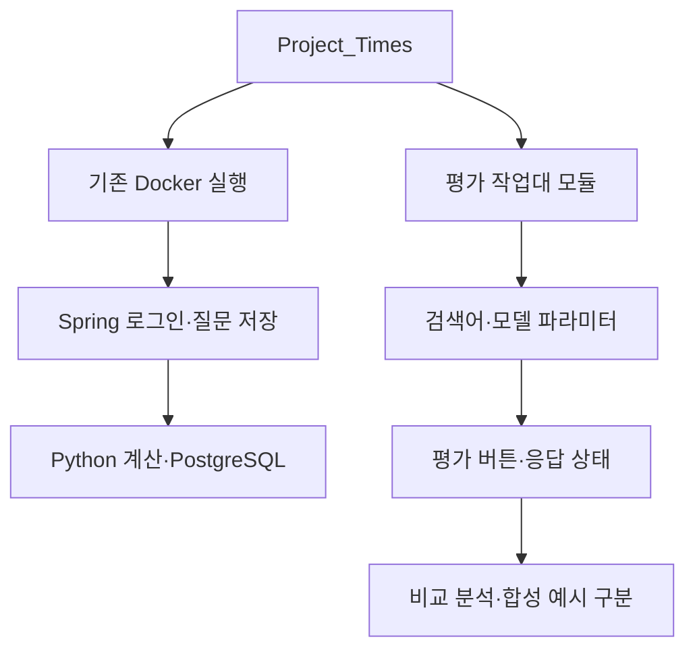

# Project_Times

공유 대화의 설계를 바탕으로 다시 구현한 **로컬 개발용 검증 작업대**입니다. Spring Boot MVC·Spring Security·JSP·Python FastAPI·PostgreSQL·Docker로 구성합니다. 실제 AI 판별 서비스의 완성본은 아닙니다.

## 코드별 설명 문서

[코드 읽기 지도](docs/CODE_GUIDE.md)에서 Python·Java·DB·JSP·프런트엔드·API·빌드·테스트·CI별 README를 확인할 수 있습니다. 각 문서는 파일별 역할, 처리 순서, 입력과 출력, 실행 방법과 검증 한계를 설명합니다.

## 질문 입력·평가 작업대

첫 화면에서 검색어를 입력하고 A~E별 파라미터를 확인한 뒤 평가 결과 화면으로 이동하는 Sites 원본을 [독립 기능 모듈](modules/evaluation-workbench/README.md)로 반영했습니다. 기존 Docker·Spring·Python·DB 실행 흐름은 아래와 같이 유지됩니다.



```sh
# Node.js 22 이상 · 외부 패키지 설치 불필요
node scripts/workbench.mjs check
node scripts/workbench.mjs start
# http://127.0.0.1:5173/
```

A~C 서버 어댑터와 입력 흐름이 구현되어 있고, 키 미등록 시 전송하지 않습니다. D·E는 후보 조사만 완료했습니다. 로컬 모듈은 UI 미리보기이며 실제 API 실행은 비활성화되어 있습니다. 기존 로그인·DB와 통합된 AI 평가 서비스라는 뜻은 아닙니다. 실제 공급자 응답의 자동 신뢰점수 산정은 구현하지 않았습니다.

[실행·검증 흐름](docs/WORKFLOW.md) · [AI 5종 비용 보고서](docs/research/Project_Times_AI_5_Model_Cost_Summary_2026-11-11.md) · [이번 검증 범위](docs/verification/WORKBENCH_2026-11-11.md)

## 시작

Docker Desktop을 실행하고 `.env.example`을 `.env`로 복사한 뒤 `DB_PASSWORD`와 16~64바이트의 무작위 `BOOTSTRAP_PASSWORD`를 설정합니다. 예제에는 비밀번호 기본값이 없어 설정 전에는 시작되지 않습니다. 기존 `.env`는 덮어쓰지 않습니다. `.env`는 커밋하지 않습니다.

```powershell
Copy-Item .env.example .env
# .env의 DB_PASSWORD, BOOTSTRAP_PASSWORD를 설정한 뒤:
docker compose up -d --build
```

브라우저에서 http://localhost:18080/login 을 엽니다. 최초 계정은 `BOOTSTRAP_USERNAME`(기본 owner)이며 `.env`의 초기 비밀번호로 로그인합니다. 이미 생성된 계정의 비밀번호는 환경변수 변경으로 자동 초기화되지 않습니다. `START_DOCKER.bat`도 같은 실행 명령을 사용합니다. 최초 설치에는 이미지·의존성 다운로드가 필요합니다. 중지는 `docker compose down`이며, DB 볼륨은 남습니다. `down -v`는 데이터를 지우므로 사용하지 마세요.

Java·Python·DB는 내부 전용 네트워크에 있고 Nginx 진입점만 로컬호스트 포트를 노출합니다. Compose의 local 프로파일만 HTTP 개발 예외를 사용합니다. 기본 프로파일은 HTTPS를 요구합니다. 운영 TLS 배포를 완료한 구성은 아닙니다.

## 현재 기능

- Spring Boot MVC·JSP 화면과 Java → Python·DB 준비 상태 확인.
- DB 기반 BCrypt 로그인, CSRF·Origin 검사, 세션 ID 회전·만료·로그아웃·단일 세션, 서버 역할 검사와 소유자별 질문 조회.
- DB에 유지되는 로그인 예산과 로그인 성공·실패 이벤트. Mock은 테스트 소스에만 존재합니다.
- 연결 확인용 질문 저장·조회. 질문 저장은 AI 검증 실행이 아닙니다.
- 7축 판정 수량의 Decimal 산술 계산, 미확인 범위, 전문가 미검토, 모순 위험 역변환.
- PostgreSQL에 원본 계산 입력·결과·정책 버전 저장. Flyway 최초 마이그레이션.
- HTTP 입력 검사·보안 헤더·로컬호스트 바인딩·컨테이너 자원 제한.

외부 텍스트는 허용 출처 검사·크기 제한 후 SHA-256과 함께 격리 저장할 수 있습니다. 기본 허용 출처는 비어 있어 거부합니다. URL 다운로드·바이너리 파서·실제 AI 호출·근거 판별·전문가 검토·레이더 차트·AI 10회 재시도·체크포인트 작업 재개는 구현하지 않았습니다. 로그인 제한의 10회와 AI 호출 예산은 다른 정책입니다.

MFA·계정 복구·운영 TLS·DB 최소 권한 분리·비밀 저장소·보안 감사는 후속 범위입니다. 외부 공개 배포에 사용하지 마세요. 자세한 위협·통제·검토 순서는 [보안 설계](docs/security/DESIGN.md)를 읽어주세요.

## 검증

```powershell
docker build --target test -t project-times-test .
docker run --rm project-times-test
.\scripts\Invoke-AuthenticatedChecks.ps1
.\scripts\Backup-Restore-Check.ps1
```

백업 복원 검사는 별도의 DB를 만들고 남겨둡니다. 실제 데이터가 있다면 로컬 백업 파일도 민감정보로 관리하세요. 실행 로그·백업은 `artifacts/`에 보관하며 Git에는 포함하지 않습니다.

인증 통합 검증에는 `.env`의 초기 비밀번호를 `TEST_LOGIN_PASSWORD` 환경변수로 안전하게 전달해야 합니다. 실제 값을 명령행 인수나 로그에 적지 마세요. 명령은 [보안 검증 기록](docs/security/VERIFICATION.md)에 있습니다. 로그인 예산의 실제 재시작 검증은 `.\scripts\Test-LoginBudget.ps1`, 장애·질문 보존 검증은 `.\scripts\Recovery-Check.ps1`을 사용합니다.

최신 설계는 [보안 설계](docs/security/DESIGN.md), 이전 기반 구조는 [구조 이력](docs/ARCHITECTURE.md), 작업 기록은 [진행 기록](docs/PROGRESS.md)을 확인하세요. GitHub Actions는 Python 테스트·Spring 보안 테스트를 포함한 웹 빌드·인증 통합 연결을 검사하도록 구성했습니다. 로컬 성공과 원격 CI 성공은 별개입니다.
