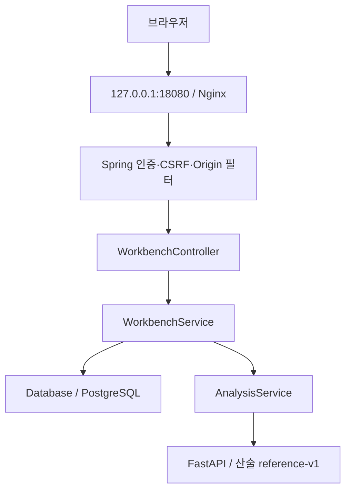

# 실제 main의 요청·데이터 흐름

`compose.yaml`은 진입점만 로컬에 노출하며 web/analysis/DB는 내부 네트워크에 둔다. 기본 프로파일은 HTTPS 요구, Compose의 local 프로파일은 개발용 HTTP 예외다. 실제 운영 TLS 검증 완료를 의미하지 않는다.

`SecurityConfig`는 API 역할과 인증을 검사한다. `WorkbenchController`가 Principal에서 소유자를 얻고 Service를 거쳐 Database에 전달한다. 질문 목록은 owner_key 조건의 파라미터 SQL 조회다. 클라이언트의 소유자 지정값을 신뢰하는 구조가 아니다.

`/api/evaluate` → Java AnalysisService → Python `/evaluate` → 입력/결과/정책 버전 저장. Python은 판정 수량을 계산하며 원문 사실을 검증하지 않는다. `PAPER_WEIGHTS`는 변경 불가 매핑, `POLICY_VERSION=reference-v1`로 관리된다. provisional은 E축을 제외해 활성 가중치를 재정규화하고 reviewed는 E축이 없으면 결과를 미확인으로 둔다. R축 구간의 양 끝은 반전한다.

외부 자료는 허용 호스트의 수동 text/plain 접수→해시→quarantined 저장이다. URL 다운로드, AI 전송, 신뢰 승격은 연결되지 않았다. Flyway V1/V2 파일은 확인했지만 실제 DB에 실행하지 않았다.

자세한 기존 근거는 [보안 설계](../security/DESIGN.md)를 따른다. 그 문서의 이미 알려진 제약을 새 결함 발견처럼 중복 보고하지 않는다.
